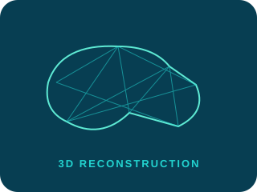
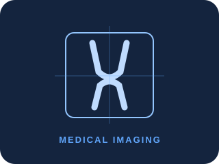
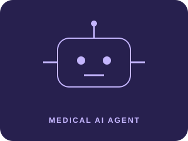
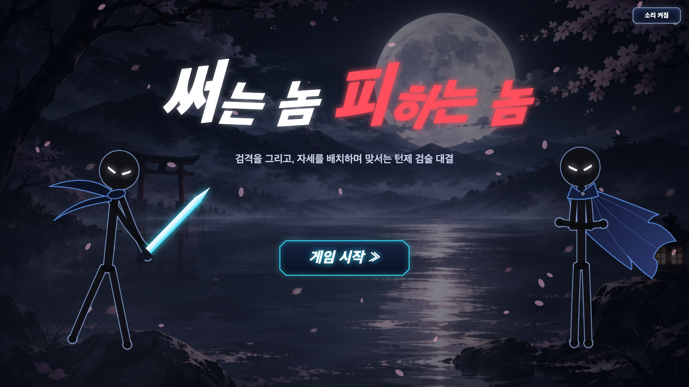

**[한국어](README.ko.md) · [English](README.md)**

# 안녕하세요, 안재형입니다 👋

**Biotechnology · Artificial Intelligence · Software Development**

---

## 👋 About Me

**생명공학, AI, 소프트웨어가 만나는 지점을 탐구합니다.**

Ghent University에서 분자생명공학을 전공했으며, 의료 AI, 3D 재구성, 차량용 앱과 게임 개발 프로젝트를 경험했습니다. 다양한 분야의 아이디어를 연결해 실제 동작하는 실험과 프로그램으로 구현하는 데 관심이 있습니다.

🎓 **학력:** Ghent University — 분자생명공학 학사

🔬 **관심 분야:** Healthcare AI · Bioinformatics · Digital Biotechnology

---

## 🚀 Project Gallery

<table>
<tr>
<td width="190" align="center" valign="middle"></td>
<td valign="top">
<h3>3D Liver Reconstruction</h3>

학사 졸업 연구 · 2026

암시적 신경 표현과 메타러닝을 활용한 환자별 3D 간 재구성 연구입니다.

INR · MAML · SIREN · 3D Reconstruction

<a href="https://github.com/shin-shuru/BSc_Project_2026">저장소</a>

</td>
</tr>
<tr>
<td width="190" align="center" valign="middle"></td>
<td valign="top">
<h3>RSNA Knee Abnormality Detection</h3>

의료 영상 AI · Kaggle 대회 · 2026

딥러닝 모델 개발과 실험을 통해 무릎 MRI의 여러 이상 소견을 분석하는 프로젝트입니다.

Medical Imaging · Deep Learning · Multi-label Classification

비공개 코드

</td>
</tr>
<tr>
<td width="190" align="center" valign="middle"></td>
<td valign="top">
<h3>N.O.V.A.</h3>

의료 AI 에이전트 · 2026

LLM 기반으로 임상 추론을 탐구하는 의료 AI 에이전트 프로젝트입니다.

LLMs · AI Agents · Prompt Engineering

<a href="https://github.com/jaehyeongahn01/nova-medical-ai">저장소</a>

</td>
</tr>
<tr>
<td width="190" align="center" valign="middle"></td>
<td valign="top">
<h3>Hyundai Pleos — 연저씨</h3>

차량용 애플리케이션 · 2026

차량 신호 기반 퀘스트와 학습 기록을 결합한 초보운전자용 운전 연수 앱입니다.

Kotlin · Android · Pleos Vehicle SDK · Gamification

<a href="https://github.com/ryu-zz/pleos-yeonjeossi">저장소</a>

</td>
</tr>
<tr>
<td width="190" align="center" valign="middle"></td>
<td valign="top">
<h3>Hyundai Pleos — Emergency</h3>

차량 안전 프로토타입 · 2026

택시 기사를 위한 은밀한 긴급 입력 감지 프로토타입입니다. 실제 메시지 발송과 실차 검증은 진행 전입니다.

Kotlin · Android · Input Pattern Detection · Automotive UX

<a href="https://github.com/jaehyeongahn01/pleos-emergency">저장소</a>

</td>
</tr>
<tr>
<td width="190" align="center" valign="middle"></td>
<td valign="top">
<h3>Game Development</h3>

인터랙티브 소프트웨어 · 2026

써는 놈 피하는 놈 — 마우스로 검격을 그리고 캐릭터를 움직여 회피하는 턴제 검술 게임입니다.

TypeScript · Vite · Canvas · Gameplay Design

<a href="https://github.com/jaehyeongahn01/game-development">저장소</a>

</td>
</tr>
</table>

앞의 세 썸네일은 분야를 나타내는 일러스트이며, 나머지는 실제 프로젝트 화면입니다.

---

## 💡 활동

<b>🏁 대회 및 팀 프로젝트</b>

- RSNA Knee Abnormality Detection
- N.O.V.A. Medical AI Competition
- Hyundai Pleos Connect App Development

<b>🎮 개인 개발</b>

- Stickman Sword Duel
- 인터랙티브 게임 기획 및 개발

---

## 🛠️ Tech Stack

<b>프로그래밍 언어</b>

<b>AI 및 데이터</b>

<b>애플리케이션 개발</b>

<b>클라우드 및 도구</b>

