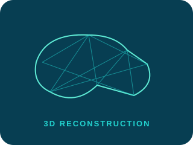
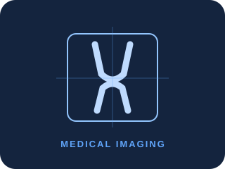
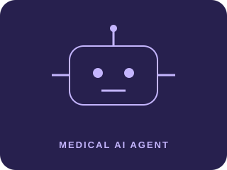
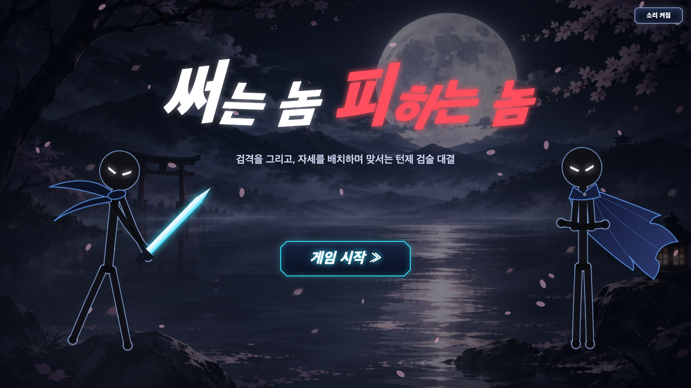

**[한국어](README.ko.md) · [English](README.md)**

# Hi, I'm Jaehyeong Ahn 👋

**Biotechnology · Artificial Intelligence · Software Development**

---

## 👋 About Me

**Exploring the intersection of biotechnology, AI, and software.**

I am a Molecular Biotechnology graduate from Ghent University, with experience in medical AI, 3D reconstruction, and interactive application development. I enjoy connecting ideas across disciplines and turning them into working experiments and software.

🎓 **Education:** Ghent University — Molecular Biotechnology

🔬 **Interests:** Healthcare AI · Bioinformatics · Digital Biotechnology

---

## 🚀 Project Gallery

<table>
<tr>
<td width="190" align="center" valign="middle"></td>
<td valign="top">
<h3>3D Liver Reconstruction</h3>

Bachelor&#x27;s research · 2026

Meta-learning for patient-specific 3D liver reconstruction with implicit neural representations.

INR · MAML · SIREN · 3D Reconstruction

<a href="https://github.com/shin-shuru/BSc_Project_2026">Repository</a>

</td>
</tr>
<tr>
<td width="190" align="center" valign="middle"></td>
<td valign="top">
<h3>RSNA Knee Abnormality Detection</h3>

Medical imaging · Kaggle competition · 2026

Multi-label knee MRI analysis through deep learning model development and experimentation.

Medical Imaging · Deep Learning · Multi-label Classification

Private source

</td>
</tr>
<tr>
<td width="190" align="center" valign="middle"></td>
<td valign="top">
<h3>XRAY ZIP</h3>

Medical imaging AI · Web platform · 2026

A chest X-ray classification and learning platform combining ResNet18 predictions, Grad-CAM visualizations, and an interactive reading challenge. Built with React and FastAPI, with AWS used for training and CPU deployment.

ResNet18 · Grad-CAM · React · FastAPI · AWS

<a href="https://github.com/jaehyeongahn01/xray-zip">Repository & demos</a>

</td>
</tr>
<tr>
<td width="190" align="center" valign="middle"></td>
<td valign="top">
<h3>N.O.V.A.</h3>

Medical AI agent · 2026

An LLM-based medical AI agent exploring clinical reasoning.

LLMs · AI Agents · Prompt Engineering

<a href="https://github.com/jaehyeongahn01/nova-medical-ai">Repository</a>

</td>
</tr>
<tr>
<td width="190" align="center" valign="middle"></td>
<td valign="top">
<h3>Hyundai Pleos — 연저씨</h3>

Automotive application · 2026

A beginner-driver coaching app with vehicle-signal quests and progress tracking.

Kotlin · Android · Pleos Vehicle SDK · Gamification

<a href="https://github.com/ryu-zz/pleos-yeonjeossi">Repository</a>

</td>
</tr>
<tr>
<td width="190" align="center" valign="middle"></td>
<td valign="top">
<h3>Hyundai Pleos — Emergency</h3>

Automotive safety prototype · 2026

A discreet emergency-input prototype for taxi drivers. Message delivery and live-vehicle validation remain pending.

Kotlin · Android · Input Pattern Detection · Automotive UX

<a href="https://github.com/jaehyeongahn01/pleos-emergency">Repository</a>

</td>
</tr>
<tr>
<td width="190" align="center" valign="middle"></td>
<td valign="top">
<h3>Game Development</h3>

Interactive software · 2026

Stickman Sword Duel — draw sword attacks and move your character to dodge in a turn-based game.

TypeScript · Vite · Canvas · Gameplay Design

<a href="https://github.com/jaehyeongahn01/game-development">Repository</a>

</td>
</tr>
</table>

The liver reconstruction, RSNA, and N.O.V.A. thumbnails are topic illustrations; the remaining images show actual projects.

---

## 💡 Activities

<b>🏁 Competitions & Team Projects</b>

- RSNA Knee Abnormality Detection
- N.O.V.A. Medical AI Competition
- Hyundai Pleos Connect App Development

<b>🎮 Independent Development</b>

- Stickman Sword Duel
- Interactive game design & development

---

## 🛠️ Tech Stack

<b>Languages</b>

<b>AI & Data Science</b>

<b>Application Development</b>

<b>Cloud & Tools</b>

